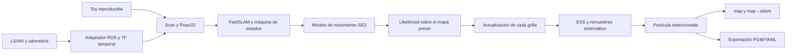
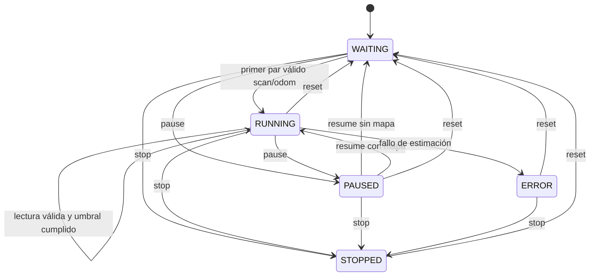

# Arquitectura de la entrega A

## Alcance y fundamento

El sistema estima una pose planar del RosMaster y un mapa de ocupación a partir del LIDAR y la odometría. Conserva una grilla independiente para cada hipótesis de trayectoria. Esta es la adaptación a grillas de la arquitectura FastSLAM/Rao–Blackwellized particle filter (RBPF). El FastSLAM original utiliza distribuciones de landmarks; aquí se reemplaza esa representación por probabilidades de ocupación condicionales a la trayectoria. Referencias: [FastSLAM original](https://robots.stanford.edu/papers/montemerlo.fastslam-tr.html) y [RBPF con grillas de Grisetti, Stachniss y Burgard](https://www.ipb.uni-bonn.de/wp-content/papercite-data/pdf/grisetti07tro.pdf).

El núcleo es Python/NumPy/SciPy, sin imports de ROS. El adaptador ROS convierte mensajes y TF en tipos del dominio. Los mismos algoritmos se ejecutan con sensores sintéticos, Gazebo, bags o el robot físico; cambia la fuente de datos y su reloj.



## Responsabilidades

Los módulos de algoritmo están en `slam/slam/core/` y no importan ROS. Los nodos están en `slam/slam/ros/` y el mundo sintético en `slam/slam/toy/`.

| Módulo | Responsabilidad |
| --- | --- |
| `config.py` | Configuración tipada, validación y carga de YAML. |
| `geometry.py` | Poses, composición/inversa en SE(2) y normalización angular. |
| `types.py` | Lecturas de rango y estructuras independientes del transporte. |
| `motion.py` | Propuesta basada en incrementos de odometría y ruido. |
| `scan_match.py` | Propuesta con scan matching contra el mapa de cada partícula. |
| `sensor.py` | Preparación de haces y likelihood de los extremos de impacto. |
| `grid.py` | Geometría de grilla, celdas observadas y modelo inverso en log-odds. |
| `filter.py` | Ciclo RBPF, pesos, selección de partícula, ESS y remuestreo. |
| `state_machine.py` | Estados y transiciones del ciclo de mapeo. |
| `io.py` | Exportación interoperable de mapas. |
| `odometry.py` | Buffer de odometría interpolada al instante del scan. |
| `toy/world.py`, `toy/cli.py` | Mundo sintético, entrada sin ROS y evaluación. |
| `ros/ros_node.py` y demás nodos | TF al tiempo de la lectura, publicación, servicios y persistencia. |

## Ciclo de estimación

Es `FastSLAM.process` en `core/filter.py`. Cada paso es un método: `_gate` (1 y 2), `_predict` (3), `_weigh` (4 y 5), `_update_maps` (6), `_update_estimate` y `_resample_if_needed` (7).

1. Validar la lectura y su timestamp. Una lectura fuera de orden no debe incorporar un movimiento espurio.
2. Obtener el incremento de odometría respecto de la última lectura integrada. Los umbrales de movimiento se acumulan desde esa referencia.
3. Muestrear la nueva pose de cada partícula con la propuesta: scan matching contra su propio mapa, o el modelo de movimiento si está desactivado o el mapa todavía está casi vacío (`_predict`).
4. Evaluar la lectura contra **el mapa previo** de esa partícula y actualizar su log-peso.
5. Normalizar los pesos en el dominio logarítmico.
6. Integrar los haces en cada grilla usando la pose propuesta y la extrínseca del sensor.
7. Conservar la partícula elegida antes de que el remuestreo reinicie los pesos; si corresponde, remuestrear sistemáticamente con copias independientes de sus mapas.

Evaluar después de insertar la lectura premiaría a una partícula por concordar con la evidencia que acaba de escribir. Compartir un mapa mutable entre descendientes destruiría la independencia de las hipótesis. Ambos son invariantes del diseño.

Se publica el mapa de una partícula coherente y su pose asociada. Promediar mapas de hipótesis desalineadas produciría paredes dobles o borroneadas. Una media ponderada de poses puede servir para describir incertidumbre, pero no sustituye la pose que corresponde al mapa publicado.

## Modelo de movimiento

Se usa el incremento relativo `odom_anterior⁻¹ ∘ odom_actual` expresado en el marco del robot. Se perturban sus componentes de traslación y rotación, y se compone el resultado con la pose de la partícula. Se conserva la componente lateral: esto permite trabajar con una base mecanum, marcha atrás y giros sobre el lugar. El modelo es planar; los coeficientes de ruido deben calibrarse con la odometría del robot.

## Grilla y modelo inverso

Para cada celda se mantienen el log-odds y un indicador independiente de observación. Se aproxima la independencia de las ocupaciones condicionadas a la trayectoria; esto permite actualizar cada celda con evidencia local. Una celda sin evidencia permanece desconocida, incluso si el prior no es 0,5. La actualización es:

```text
logit(p) = log(p / (1 - p))
L_t(c) = clip(L_(t-1)(c) + logit(p_inverso(c)) - logit(p_prior), L_min, L_max)
p(c) = 1 / (1 + exp(-L_t(c)))
```

Los haces libres reducen la ocupación; un retorno válido aumenta la ocupación cerca de su extremo. Se limita la confianza con saturación. Las celdas detrás de un impacto no reciben evidencia libre. Los límites del mapa son geométricos: un retorno exterior no se recorta a la frontera para inventar una pared.

El tamaño de celda controla tanto el detalle como el costo. Duplicar la resolución espacial —pasar de 10 cm a 5 cm por celda— cuadruplica las celdas del mismo entorno. El mapa exportado mantiene libres, ocupadas y desconocidas separadas; la inflación por el radio del robot pertenece al planificador/costmap de B.

## Likelihood, pesos y remuestreo

La ponderación utiliza la cercanía de los extremos de retorno a obstáculos del mapa previo. Se combina una componente de impacto con una componente uniforme; la distancia máxima y la temperatura de likelihood limitan penalizaciones extremas y la sobreconfianza de haces correlacionados. Es una aproximación práctica del modelo directo de medición, distinta del modelo inverso que escribe el mapa. Los perfiles actuales activan una propuesta con scan matching propio; los YAML sin ese grupo conservan la odométrica. La nueva propuesta devuelve corrección de importancia cero: es una aproximación, no FastSLAM 2.0 exacto. Ver [002](decisiones/002-propuesta-con-scan-matching.md) y [la revisión del 16/11](revision_20261116.md).

```text
w_t(i) ∝ w_(t-1)(i) · p(z_t | x_t(i), m_(t-1)(i))
N_eff = 1 / sum_i(w_t(i)²)
remuestrear si N_eff < resample_ess_ratio · N
```

La selección por ESS evita remuestrear innecesariamente. El remuestreo sistemático usa un único desplazamiento aleatorio y puntos equiespaciados en la distribución acumulada. Una semilla hace reproducible la secuencia de muestreo; el runtime depende del equipo.

## Máquina de estados

El mapeador separa el estado operativo de los pasos internos de estimación:



Los servicios del adaptador solicitan esas transiciones. Una lectura transitoriamente sin TF se espera o descarta con diagnóstico; no se debe tratar como una pose cero. `reset` inicia un mapa nuevo. `pause` no constituye un mecanismo de parada del robot: este paquete se ocupa del mapeo y no controla motores.

## Tiempo, marcos y transporte

La cadena esperada es `map → odom → base → laser`, con `base_footprint` como base por defecto y nombres configurables. El nodo estima `map → odom`; la base/simulador/bag suministra `odom → base`; el URDF o una extrínseca explícita suministra `base → laser`. No deben competir dos autoridades por `map → odom`.

Las transformaciones se consultan al tiempo de adquisición del scan. El mensaje [LaserScan de Humble](https://github.com/ros2/common_interfaces/blob/humble/sensor_msgs/msg/LaserScan.msg) define el timestamp como la adquisición del primer haz. Esta versión aproxima el scan por una pose única; la corrección del movimiento durante cada barrido queda como extensión. Por ello bajar la tasa de reproducción de un bag reduce la presión de cómputo, pero no repara las distorsiones físicas de un barrido tomado mientras el robot giraba rápidamente.

## Extensiones previstas

- **Scan matching exacto:** completar la corrección de importancia de la propuesta informada por el scan y el mapa previo ya implementada. Si cambia la distribución de propuesta, también debe cambiar el cociente de importancia; desplazar partículas y conservar la ecuación de pesos actual no implementa FastSLAM 2.0 correctamente.
- **Fusión sensorial:** generar observaciones con extrínsecas y timestamps propios, con modelos de likelihood e inversos específicos. Una imagen RGB no es un sensor de rango sin una estimación de profundidad; proyectar profundidad exige filtrar suelo, techo y alturas relevantes.
- **Odometría/IMU:** mejorar la fuente de `odom → base_link` con un estimador externo, evitando contar dos veces la misma evidencia en pesos independientes.
- **Mapas más grandes:** sustituir copias densas por tiles o copy-on-write, manteniendo la independencia lógica entre partículas.
- **B:** cargar PGM/YAML, localizar en un mapa fijo y construir un costmap inflado con unknown conservador. Navegación, `/initialpose`, `/goal_pose`, control y evasión quedan fuera de la implementación de A.
- **C:** sumar exploración activa y percepción de conos rojos, pasando sus posiciones al planificador para respetar paredes y aberturas.

## Límites de esta primera versión

El filtro puede favorecer una hipótesis consistente al revisitar un lugar si esa hipótesis sigue viva. No optimiza retrospectivamente un grafo ni deforma mapas históricos para cerrar lazos. La pérdida de diversidad puede volver irrecuperable una deriva. El mapa es 2D y estático; personas, superficies reflectantes, rampas, deriva sistemática y falta de calibración requieren evaluación adicional. Los mapas densos hacen crecer la memoria con el número de partículas y el área. La validación sintética no demuestra por sí sola el cumplimiento geométrico de la consigna en el laboratorio.
