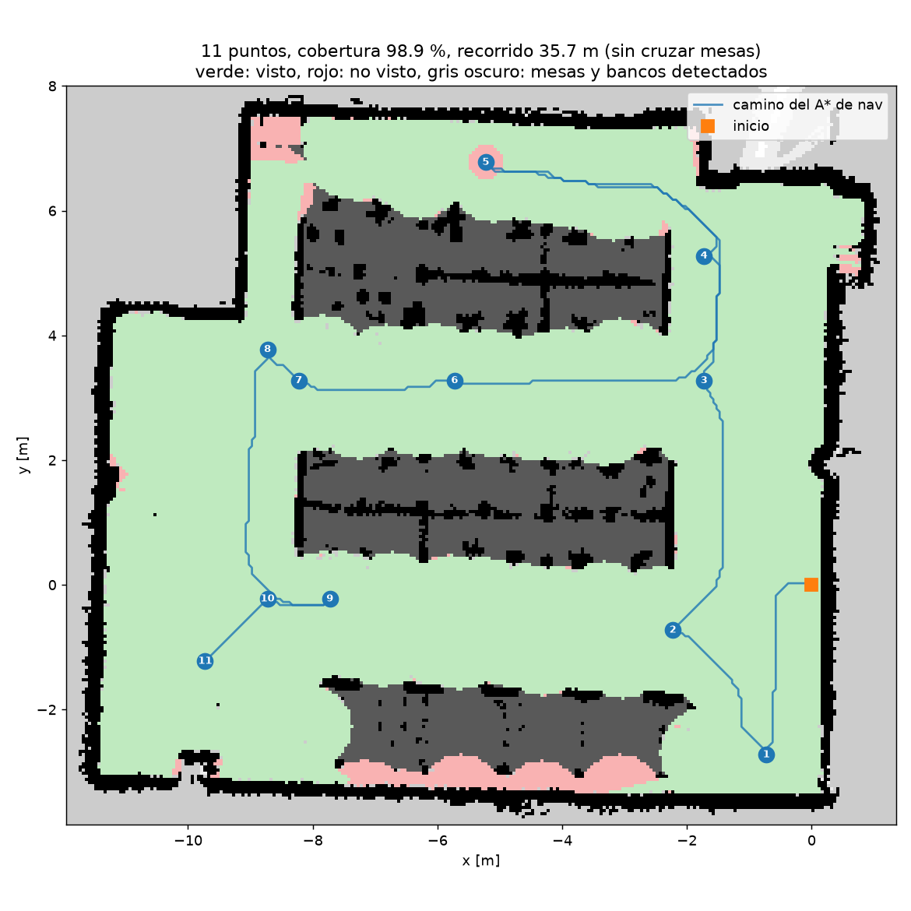

# 014. Exploración por puntos de observación

Estado: decidida el 2026-11-20 e implementada el 2026-11-23 en `mission/mission/core/exploration.py`, con tests sin ROS. Falta probarla en Gazebo y en el robot.

## Problema

La consigna de la etapa C pide que el robot recorra el aula solo buscando conos rojos, y la pregunta 3 del informe pide justificar hacia dónde explorar mientras todavía no vio ninguno. La cámara ve hacia adelante, unos 60 grados, y detecta un cono con confianza hasta unos pocos metros.

## Qué explorar

| Opción | A favor | En contra |
|---|---|---|
| A. Mapa conocido de la etapa A y localización de la etapa B; explorar es mirar toda el aula con la cámara | Reusa A y B sin cambios: la misión solo manda objetivos por `/goal_pose`. El plan se calcula una vez y se puede revisar antes de ir al laboratorio | Si el aula cambió mucho respecto del mapa, el plan no lo sabe |
| B. SLAM en vivo y exploración por fronteras (ir al borde entre lo libre y lo desconocido) | No necesita mapa previo | SLAM y navegación nunca corrieron juntos. Las fronteras del lidar no dicen qué vio la cámara, que tiene otro alcance y otro campo de visión |

Elegí A. El aula ya está mapeada, y lo que falta no es saber dónde están las paredes sino qué parte del piso miró la cámara.

## Cómo elegir los puntos

| Opción | A favor | En contra |
|---|---|---|
| A. Automáticos: cubrir con la cámara las celdas libres, eligiendo de forma codiciosa entre candidatos transitables | Funciona con cualquier mapa y se puede medir la cobertura | Hay que modelar qué ve la cámara |
| B. A mano, en un YAML | Simple y predecible | Hay que rehacerlo si cambia el mapa, y se justifica peor |
| C. Recorrido fijo tipo cortadora de pasto | Sin cálculo | Pasa por lugares que ya vio; el aula tiene mesas que lo cortan |

Elegí A, con B como respaldo: si `exploration.viewpoints` tiene puntos, se usan esos en ese orden. Si se usa el respaldo, los puntos se fijan antes de saber dónde se colocaron los conos.

Detalle de A:

- **Objetivo:** las celdas libres conectadas con la zona adonde puede ir el robot. Es donde puede estar un cono.
- **Candidatos:** celdas transitables del mapa de costos de `nav` (el mismo que usa el navegador, así llega a todos), cada 0,5 m, con al menos `viewpoint_clearance` de holgura a los obstáculos.
- **Visibilidad:** rayos en 2D sobre el mapa que se cortan en la primera pared o zona desconocida, entre 0,3 m (mínimo de la cámara de profundidad) y 3 m.
- **Selección codiciosa:** primero el candidato que más área ve, después el que más área nueva agrega, hasta ver el 98 % de lo que se puede ver desde algún candidato o hasta que el próximo agregue menos de 0,5 m². Es la aproximación clásica a cubrir un conjunto, que es NP-difícil.
- **Orden:** vecino más cercano desde la pose inicial y después 2-opt, con distancias por la zona transitable (Dijkstra sobre la grilla). El camino real lo calcula el A* del navegador.

## Mesas y bancos

El lidar está a 18 cm del piso: de las mesas ve solo las patas y de los bancos el borde delantero y alguna pata suelta. El mapa los muestra casi libres. Sin corregirlo, el plan ponía puntos entre los bancos, contaba como piso a buscar el área debajo de las mesas, y la visibilidad 2D generaba sombras detrás de cada pata.

Las etapas A y B no lo resuelven: todo trabaja en el plano del lidar y ninguna usa la cámara de profundidad. La 008 deja como "sin probar" los obstáculos más bajos que el plano del lidar, y la 011 el riesgo de enganchar la base de una silla. Los mapas del aula disponibles (`intento3`, `intento3_corregido` y los replays del mismo bag en `slam/artifacts/hitl_bag16_*`) son prácticamente iguales: ninguno tiene esa información, y la grilla cruda guardada tiene todas las celdas libres saturadas, así que tampoco sirve la confianza de cada celda.

| Opción | A favor | En contra |
|---|---|---|
| A. Detectarlas del mismo mapa del lidar: una zona de mesas es un amontonamiento de obstáculos chicos | Sin intervención humana; funciona con cualquier mapa | Aproximado: bordes irregulares, y no distingue una mesa de cualquier otro grupo de obstáculos cercanos |
| B. Detectar mesas y bancos con la cámara de profundidad | Ve la tabla de la mesa y el asiento del banco, lo más fiel | Bastante más trabajo: nube de puntos, TF de la cámara, una capa de obstáculos 3D |

Elegí A. B queda como trabajo futuro.

Detalle de A (`prepare_map`):

1. **Paredes y muebles.** Lo desconocido conectado con el borde de la grilla es el exterior del aula. Un obstáculo cuya componente conexa toca ese exterior es pared; el resto (patas, bordes de mesas y bancos) es mueble. Lo desconocido de adentro, como detrás de una pata, no cuenta.
2. **Cierre morfológico de los muebles** con un disco de radio `clutter_radius`: dilatar y erosionar. Dos muebles a menos de dos radios se unen; un paso más ancho no se cierra. Las paredes no entran, así el pasillo entre un mueble y la pared no se tapa (sin separarlas, el pasillo entre el bloque de mesas de arriba y la pared izquierda se cerraba).
3. **Relleno** de los huecos encerrados de menos de `clutter_max_hole`: el interior de un bloque, no el aula entera, que también está encerrada por paredes.
4. Los bloques se marcan como ocupados en una copia del mapa: tapan la vista, no son piso donde buscar y el mapa de costos los infla. El mapa de `nav` no cambia.
5. **Holgura:** el robot no se para a mirar a menos de `viewpoint_clearance` de un obstáculo.

Se comprobó que el A* de `nav`, sobre el mapa original, ya rodea los bloques detectados en los trayectos entre puntos: ningún punto de esos caminos cae en ellos.

### Información humana que usa la misión

- El mapa del aula viene de la etapa A, hecho por el robot, y las mesas y bancos salen de ese mismo mapa.
- Parámetros elegidos por nosotros: alcance y campo de visión de la cámara, radio de cierre, holgura, cobertura objetivo. Son generales, no propios del aula, y se calibraron con los criterios de abajo.
- Nunca se usa información sobre dónde están los conos.

## Qué hacer en cada punto

| Opción | A favor | En contra |
|---|---|---|
| A. Girar 360 grados siempre | Simple | Gira hacia lo que ya vio, en el punto o en el camino |
| B. Girar solo hacia lo que falta | Menos giros. Se registra lo que la cámara vio de verdad, también mientras se desplaza | Hay que llevar la cuenta de la cobertura |

Elegí B. `CoverageTracker` marca como visto lo que entra en el campo de visión desde cada pose. En cada punto elige, entre 36 direcciones, la que muestra más área sin ver, y así hasta que la próxima agregue menos de 0,05 m². Las direcciones se ordenan para girar poco.

## Datos

Mapa del aula `sesiones/20261116/mapa/intento3_corregido`, mapa de costos de `nav/config/real.yaml` (radio 0,17 m más 0,05 m), inicio en (0, 0). Cálculo en menos de 2 s.

Sin detectar mesas, con recorrido en línea recta (106 m² de piso como objetivo):

| `coverage_target` | Puntos | Cobertura | Recorrido (m) |
|---|---|---|---|
| 0,95 | 16 | 95,2 % | 33,7 |
| 0,90 | 11 | 90,9 % | 30,0 |

Lo que faltaba eran casi todo sombras de patas, y dos puntos caían entre los bancos.

Calibración de la detección. Criterios, sin referencia externa: que los bloques no tapen pasillos (área transitable perdida fuera de los bloques), que el robot no pueda meterse entre los bancos (área alcanzable debajo de la ruta principal) y el tamaño del plan. Se probó con `viewpoint_clearance` 0,45 y 0,50 y en tres mapas del mismo bag (`intento3_corregido`, `intento3` y el replay E16): todos dan 9 a 11 puntos, 95 a 98 % de cobertura y 29 a 36 m. Con `viewpoint_clearance` 0,50 y `coverage_target` 0,97, en `intento3_corregido`:

| `clutter_radius` (m) | Puntos | Recorrido (m) | Bloques (m²) | Transitable perdido fuera de los bloques (m²) | Alcanzable entre los bancos (m²) |
|---|---|---|---|---|---|
| sin detección | 11 | 30,0 | 0 | 0 | 3,53 |
| 0,55 | 11 | 32,2 | 18,0 | 1,15 | 1,38 |
| 0,60 | 11 | 32,2 | 18,8 | 0,79 | 1,37 |
| 0,65 | 10 | 34,6 | 21,5 | 0,14 | 0,40 |
| 0,70 | 10 | 34,6 | 21,9 | 0,10 | 0,37 |

Con 0,60 los bancos quedan en tres bloques con pasillos entre medio adonde el robot puede llegar. Con 0,65 la fila de bancos es un solo bloque. De ahí en adelante casi no cambia, pero un radio mayor cierra pasos más anchos (dos radios = 1,3 m con 0,65), lo que en otro mapa puede tapar un pasillo real. **Elegí 0,65**, el menor radio que cierra los bancos. Con 0,97 de cobertura el pasillo entre el bloque de mesas de arriba y la pared izquierda quedaba visto en un 56 %; con 0,98, en un 83 %, a cambio de un punto y 1,1 m más:

| `coverage_target` | Puntos | Cobertura | Recorrido (m) |
|---|---|---|---|
| 0,97 | 10 | 97,7 % | 34,6 |
| 0,98 (elegido) | 11 | 98,9 % | 35,7 |
| 0,99 | 12 | 99,5 % | 38,7 |

Plan elegido (`mission/config/real.yaml`), con los caminos del A* de `nav`:



Lo que queda sin ver es la franja entre la fila de bancos y la pared de abajo, adonde el robot no llega, y bordes chicos.

En el primer punto, sin haber visto nada, la vuelta completa pide unas 9 direcciones. Después de mirarlas no queda ninguna.

Reproducir la imagen, desde `mission/`:

```bash
PYTHONPATH=../slam:../nav:. python3 scripts/plot_viewpoints.py \
  ../sesiones/20261116/mapa/intento3_corregido/map.yaml \
  --nav-config ../nav/config/real.yaml --config config/real.yaml --start 0 0 --paths \
  --output artifacts/viewpoints_intento3.png
```

## Limitaciones

- Visibilidad 2D en el plano del lidar: las patas que quedan fuera de los bloques siguen tapando de más.
- Los bloques no distinguen una mesa de cualquier otro grupo de obstáculos cercanos, y debajo de ellos no se busca: un cono puesto debajo de una mesa o un banco no se buscaría.
- Si el mapa no tiene exterior desconocido (un aula sin borde gris), todo obstáculo cuenta como mueble y el cierre puede tapar pasillos junto a las paredes.
- La cámara se supone en el centro del robot.
- El plan cuenta solo lo que se ve desde los puntos, no en el camino: un punto aislado, como el 5, muestra su propio disco ciego de 0,3 m en rojo. En la misión, `CoverageTracker` también registra lo visto en movimiento.
- Un cono justo sobre un punto de observación: como el robot solo avanza y gira, la cámara mira hacia el punto durante la aproximación y el detector, que corre también en movimiento, debería verlo antes de llegar. Si el cono mide más que la altura del lidar (18 cm), además lo frena la parada de seguridad de B. Si mide menos y el detector falla en ese tramo, el robot puede chocarlo. La máquina de estados tiene que interrumpir la exploración al detectar y saltear un punto que el navegador abandone. Probar en Gazebo con un cono sobre un punto.
- Las distancias del recorrido no incluyen el costo de cercanía del A*: el camino real puede ser algo más largo.
- `camera_fov` y `view_range` son supuestos: el campo de visión se confirma con `camera_info` en la visita 1 y el alcance con el detector sobre `bag_conos`.

Pendiente: tiempo total de la exploración en Gazebo y en el robot, cuántos giros se ahorra B frente a A, y repetir la calibración si la etapa B pasa a usar un mapa nuevo.
